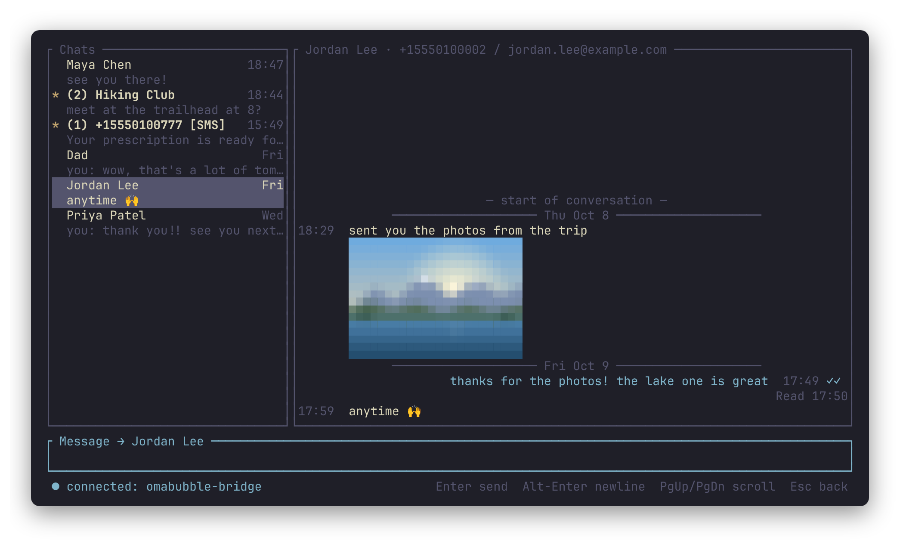
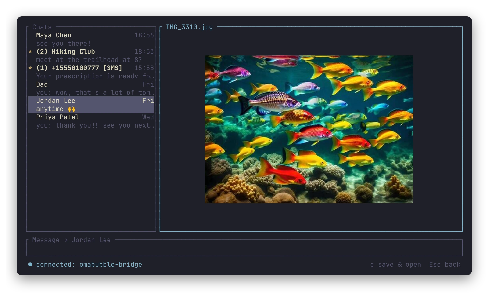

# omabubble

iMessage in a terminal on [Omarchy](https://omarchy.org), or any other Linux
machine. A Mac that stays signed in to Messages runs **`omabubble-bridge`**;
the TUI **`omabubble`** talks to it over SSH. You get your chats with Contacts
names, live updates, delivery and read status, pictures, and sending, without
the Mac's screen.

omabubble is an independent project, not affiliated with or endorsed by Apple,
and not an official Omarchy project. iMessage and Messages are trademarks of
Apple Inc.

<table>
  <tr>
    <td></td>
    <td></td>
  </tr>
  <tr>
    <td></td>
    <td></td>
  </tr>
</table>

The screenshots use made-up demo data. They show pictures the way terminals
with a graphics protocol (foot, kitty, Ghostty) do; other terminals, and
anything inside tmux, get coarse half-block characters instead.
`scripts/demo/run.sh` runs omabubble against the demo data with a
local bridge, so no Mac is needed (sends are dry runs), and
`scripts/demo/screenshots.sh` regenerates the images.

## How it works

```
omabubble (Linux) ──ssh, restricted key──> omabubble-bridge connect ──unix socket──> omabubble-bridge serve (LaunchAgent)
                                                                             ├─ reads ~/Library/Messages/chat.db (read-only)
                                                                             ├─ watches it with FSEvents, pushes new/edited/unsent messages
                                                                             └─ sends through Messages.app with osascript
```

The only network port is SSH. Full Disk Access is granted to `omabubble-bridge`
alone, not to sshd.

## Requirements

- **A Mac** signed in to Messages that stays logged in and awake. So far
  this has only been tested on macOS 15 Sequoia (Intel); other versions may
  store Messages data differently. It needs the Xcode Command Line Tools
  (`xcode-select --install`) and [mise](https://mise.jdx.dev) to build the
  bridge.
- **A Linux machine** with a terminal; on Omarchy (or any Hyprland setup)
  clicking a notification jumps to the chat.
- **SSH** from the Linux machine to the Mac.

The Rust version is pinned in `mise.toml`; mise installs it on first build.

## Setup

### 1. The Mac

1. **Turn on SSH:** System Settings → General → Sharing → Remote Login.
2. **Get the code:** clone this repository anywhere, e.g.
   `git clone https://github.com/roib/omabubble.git`, and `cd` into it.
3. **Create a signing identity,** once:
   `scripts/mac/make-signing-cert.sh`. It's a self-signed code-signing
   certificate in its own keychain (no prompts). Signing every build with it
   makes macOS treat new versions as the same app, so Full Disk Access and
   Automation survive updates; unsigned builds lose both every time the
   binary changes.
4. **Install the bridge:** run `scripts/mac/install-bridge.sh` in a terminal
   on the Mac; it asks for your password. It builds and signs the bridge,
   puts it at `/usr/local/bin/omabubble-bridge` and the agent at
   `/Library/LaunchAgents/com.omabubble.bridge.plist`, both root-owned (see
   Security), and loads the agent into your login session. Logs go to
   `~/Library/Logs/omabubble-bridge.log`. Run it again to update.
5. **Full Disk Access:** go to System Settings → Privacy & Security → Full
   Disk Access, click **+**, and add `/usr/local/bin/omabubble-bridge`
   (⌘⇧G in the file picker to type the path). The agent retries every 10s
   and starts once this is granted.
6. **Automation permission:** the first real send makes macOS ask whether
   `omabubble-bridge` may control Messages. Click Allow. If you miss the
   prompt, sends fail with `-1743`; turn it on under Privacy & Security →
   Automation.
7. **Stay reachable:**
   - Keep the Mac logged in. Messages.app itself can stay closed: incoming
     messages are written to chat.db by a background daemon, and a send
     launches Messages through AppleScript when needed.
   - Turn on "Prevent automatic sleeping" (Energy settings) or run `caffeinate`.
   - For SMS (green bubble) contacts, turn on Text Message Forwarding to this
     Mac on the iPhone.
   - **If macOS runs in a virtual machine** (for example Parallels or UTM on
     a Mac): its clock stops while the host Mac sleeps and macOS doesn't
     catch up, which delays messages. `scripts/mac/install-timesync.sh`
     installs a root job that sets the clock from time.apple.com every 2
     minutes. omabubble shows `⚠ Mac clock … behind` in the status bar when
     the Mac's clock is more than 2 minutes off.

To remove the service, run `sudo omabubble-bridge uninstall`.

**Re-granting permissions** is only needed if the binary's identity changes,
for example after switching from unsigned to signed or recreating the
certificate. Remove `omabubble-bridge` from the Full Disk Access list and add
it again, then allow the Automation prompt on the next send. On the Mac, this
opens both windows for you:
`open -R /usr/local/bin/omabubble-bridge; open "x-apple.systempreferences:com.apple.preference.security?Privacy_AllFiles"`

### 2. A restricted SSH key

This key can only reach the bridge.

- On Linux: `ssh-keygen -t ed25519 -f ~/.ssh/omabubble -N ''`
- On the Mac, add one line to `~/.ssh/authorized_keys`:
  ```
  restrict,command="/usr/local/bin/omabubble-bridge connect" ssh-ed25519 AAAA…(contents of ~/.ssh/omabubble.pub)
  ```
  `restrict` turns off pty, port/agent/X11 forwarding and `~/.ssh/rc`.
- On Linux, add to `~/.ssh/config`:
  ```
  Host mac-omabubble
      HostName your-mac.local
      User your-mac-username
      IdentityFile ~/.ssh/omabubble
      IdentitiesOnly yes
  ```

For use away from home, use Tailscale and the Mac's Tailscale name rather
than forwarding port 22 on your router.

### 3. Linux

Install the TUI from the latest release (x86_64):

```sh
cd ~/.local/bin
curl -fsSLO https://github.com/roib/omabubble/releases/latest/download/omabubble-linux-amd64
curl -fsSLO https://github.com/roib/omabubble/releases/latest/download/omabubble-linux-amd64.sha256
sha256sum -c omabubble-linux-amd64.sha256 && mv omabubble-linux-amd64 omabubble && chmod +x omabubble
```

or build it: `mise exec -- cargo build --release -p tui` (→
`target/release/omabubble`).

Then create `~/.config/omabubble/config.toml`; running `omabubble` without
one prints a sample with every option. The main ones:

```toml
host = "mac-omabubble"
country_code = "1"      # prepended to 10-digit numbers in the new-conversation popup
notifications = true    # notify-send for messages in chats you aren't looking at; on Hyprland, clicking one opens the chat in omabubble's window
notification_detail = true  # "sender": who wrote, no preview; false: only "New message" (see Security)
notification_seconds = 20   # how long banners stay up; 0 = until dismissed (Omarchy allows 8–30)
bell = false
# ssh_args = ["-p", "2222"]                                        # if the host alias doesn't cover it
# remote_command = "/usr/local/bin/omabubble-bridge connect"       # only for keys without a forced command
```

Then run `omabubble`, or `omabubble <host>` to override the configured host.

## One person, several handles

`chat.db` keeps a separate chat row per handle, so a contact you message by
both phone number and email has two rows, and Messages may file your sent copy
under either. Messages.app shows them as one conversation by consulting
Contacts, and the bridge does the same: it reads each card's phone numbers,
email addresses and link id from `~/Library/Application Support/AddressBook/`
(covered by the Full Disk Access grant), matches them against the handles in
`chat.db`, and tells the TUI which handles belong to one person. With
`names = true` (the default) the chat list shows the Contacts name, the
conversation title shows the name with its handles, and group messages are
prefixed with the sender's name. Set `names = false` to see handles only;
then only the groupings cross the wire.

For someone Contacts doesn't link, add an override:

```toml
[[person]]
name = "Alex"            # optional: shown instead of the handles
handles = ["+15551234567", "alex@example.com"]
```

If a sent copy still lands in a sibling chat that isn't merged, the TUI counts
it as sent and shows a hint naming the two handles. `omabubble-bridge serve
--no-contacts` turns the Contacts lookup off, and `omabubble-bridge query people`
prints only counts.

## Keys

| Where | Key | Action |
|---|---|---|
| Chat list | `j`/`k`, arrows, `g`/`G` | Move |
| | `Enter` | Open chat |
| | `n` | New conversation (number or email) |
| | `d` / `Delete` | Hide the chat on this machine until a new message arrives (the Mac and phone keep it); `u` undoes the last hide |
| | `o` | Open the newest link in the open conversation (and select its message) |
| Anywhere | `Tab` / `Shift-Tab` | Cycle focus: list → messages → input |
| | `PgUp` / `PgDn` | Scroll; at the top, older history loads |
| | `q` (outside the input), `Ctrl-C` | Quit |
| | `r` | Reconnect now, when disconnected |
| Input | `Enter` | Send |
| | `Alt-Enter` | Newline |
| | `Ctrl-W` / `Ctrl-U` | Delete word / clear |
| | `:` + two letters | Emoji completion (`:thu` → 👍); Tab/↑↓ choose, Enter insert, Esc close. A full `:fire:` converts when you type a space |
| | `Ctrl-E` | Emoji picker: recently used first, type to search by shortcode or name |
| | `Ctrl-A` | Attach a file: type a path and pick from the matches below it, newest first. `Tab` completes, then moves down the list; `↑`/`↓` choose; `Enter` attaches a file or opens a folder. On a wide enough terminal, the file shown is previewed beside the list |
| | `Backspace` in an empty input | Take off the last attached file |
| | `Esc` | Back to the list (what you typed stays as that chat's draft) |
| Messages pane | `j`/`k` | Select a message |
| | `y` | Copy the selected message |
| | `Y` | Copy with `[time sender]` |
| | `v` | Start or cancel a range; `y`/`Y` then copy the range |
| | `Enter` on a failed message | Put its text back in the input to resend |
| | `Enter` on a message with pictures | View them full-pane: `←/→` between pictures, `o` save to `~/Downloads` and open, `Esc` back |
| | `o` on a message with a link | Open it in your browser; with several links, choose one first. Only `http`/`https` and `www.` links open. Without a display (over SSH), it's also copied, in case it can't open there |
| | `x` on a failed message | Discard it |
| | `Esc` | Cancel range / back |

Pasting uses bracketed paste, so multi-line text lands in the input box and
isn't sent until you press Enter. Copying writes OSC 52 (works over SSH, and in
tmux with `set-clipboard on`), and also uses `wl-copy`/`xclip` when available.

Unsent text stays with its chat: switch away and the chat list shows
`✎ Draft: …` in place of the last message (or a `✎` after the name while it
has unread messages); switch back and it's in the input again. Sending or
emptying the input clears it. Drafts are saved to
`~/.local/state/omabubble/drafts.json` (readable only by you), about two seconds
after you stop typing and when you quit, so they survive restarts. They stay
on this machine.

**Sending files:** drop a file onto the terminal (foot, kitty and Ghostty
paste its path), paste a path, or press `Ctrl-A` and type one. It shows above
the input as `📎 name size`; attach several if you like, add text or not, and
press Enter. Files go first, one at a time, then the text, so they arrive in
that order; each shows `uploading 40%` until it's on the Mac, then `sending…`
until Messages records it. Files are sent as they are, up to 100 MB (about
iMessage's own limit). The file has to be on the machine omabubble runs on: a
path dropped onto a terminal on another computer is pasted as text instead.

Pictures show as thumbnails in the conversation, 8 rows tall, loaded as they
scroll into view. foot draws them with Sixel, kitty and Ghostty with the Kitty
protocol, and other terminals (and anything inside tmux, screen or zellij) with
coarse half-block characters. A picture only partly on screen shows its name
until it's fully in view. Other attachments stay text labels; set
`images = false` to show pictures as labels too. Select a message with
pictures and press Enter to view them full-pane (up to 1600 px); `o` saves the
one shown to `~/Downloads` (the right way up, without metadata) and opens it.

Mouse: click a chat to open it, click a pane to focus it (a click in the
messages pane also selects that message), and scroll with the wheel. Because
the app captures the mouse, hold Shift to drag-select text with the terminal;
or set `mouse = false` to leave the mouse to the terminal entirely.

## Send status

| Shown | Meaning |
|---|---|
| `sending…` | Handed to the bridge, waiting for the message to appear in chat.db |
| time | Confirmed: the message is in chat.db |
| `✗ failed` | osascript failed (the reason flashes in the status bar), or Messages marked it with an error. A failed message keeps its place as newer ones arrive; select it and press Enter to resend or `x` to discard |
| `? unconfirmed` | The bridge said it sent, but no copy appeared in chat.db within 30s; or the bridge never answered (it waits up to 2 minutes for Messages, e.g. for a permission dialog); or the connection dropped mid-send |
| `10:42 ✓` / `10:42 ✓✓` | After the time on every message you sent: delivered / read (`Read` needs the other person to share read receipts) |
| `10:42 SMS` | Went over SMS; text messages are green, iMessages blue |
| `10:42 ✗` | Messages accepted the send but reported a failure later; the status bar flashes once, and the chat list shows `✗` |
| `Delivered` / `Read 10:44` / `Sent as Text Message` / `Not Delivered` | Spelled out under your latest message only |

## Limitations

- Edits and unsends from other people (or your phone) show up, but you can't
  edit or unsend from the TUI: AppleScript has no command for either.
- Reading a chat here doesn't mark it read on the Mac or phone.
- Sending your own read receipts, typing indicators and tapbacks isn't
  supported.
- New messages only arrive while the Mac is awake and online. After a
  reconnect, the TUI catches up on everything it missed.

## Security

What the design protects against, and what it doesn't.

- **Network:** the only inbound port is SSH, key-only, and the omabubble key is
  `restrict`ed to the forced command `omabubble-bridge connect`: no shell, no pty,
  no forwarding. The bridge's socket is local-only, 0600 in a 0700 directory.
  Use Tailscale for remote access rather than exposing SSH.
- **The Linux box is fully trusted.** Whoever holds `~/.ssh/omabubble` can read
  every message, see which handles Contacts groups together (and names, if
  `names = true`), and send as you. The key has no passphrase for
  convenience; treat the file accordingly.
- **Same-user processes on the Mac can use the bridge.** Full Disk Access
  belongs to `omabubble-bridge`, and the bridge serves whatever connects to its
  socket. Other *users* are kept out by the socket permissions, but anything
  already running as you, with no Full Disk Access of its own, can connect,
  read all your messages and send through it. That is inherent to this
  design (a BlueBubbles server has the same property, over the network).
  Don't run the bridge on a Mac where you run software you don't trust.
- **Root-owned binary and plist.** Because the signing key lives in a
  keychain on the same account, code running as you could re-sign its own
  binary as `com.omabubble.bridge`. It can't swap it into `/usr/local/bin` or
  `/Library/LaunchAgents` without your password, which is why those are
  root-owned. Keep SIP enabled; nothing here needs it off.
- **Logs** never contain message text or recipients: send failures are
  logged with phone numbers and emails redacted, and `--dry-run-send` is the
  only mode that logs a message's argv.
- **Notifications** carry the sender and a preview, and desktops (Omarchy
  included) keep a notification history on disk. Set
  `notification_detail = "sender"` to show who wrote but not what, or
  `false` to notify with just "New message".
- **Pictures:** a request names an attachment by id, never a path. The bridge
  serves it only if chat.db lists it as a picture type (JPEG, PNG, GIF, HEIC,
  WebP, TIFF), the file sits inside `~/Library/Messages/Attachments` once `~`
  and symlinks are resolved, and it's under 50 MB. `sips` converts it to a
  resized JPEG in a private temp directory that's removed straight after; the
  bridge then strips every EXIF, XMP, IPTC and comment block (location
  included) and sends the orientation separately. Previews over 2 MB are
  refused. Nothing is
  cached on disk on either machine.
- **Sending files:** the TUI uploads a file in pieces over the same SSH
  connection; it never names a path on the Mac. The bridge writes it to a
  folder of its own choosing inside `~/Library/Messages/Attachments/omabubble`
  (Messages is sandboxed and sends files from there), under a cleaned-up
  name, checks the size against what was announced (100 MB at most, four
  uploads per connection at once), and passes the path to `osascript` as
  argv. Unfinished uploads are deleted when their connection ends, and sent
  files after a day.
- **Input handling:** recipients and message text reach `osascript` as
  argv, never spliced into the script; all SQL is parameterised except
  integer chat ids; request lines over 1 MiB are rejected.
- Check dependencies for known vulnerabilities with `cargo audit`.

## Development

Everything can run against a fake database, without touching real messages:

```sh
sqlite3 /tmp/fx.db < bridge/tests/fixtures/make_fixture.sql
cargo run -p bridge -- serve --db /tmp/fx.db --socket /tmp/omabubble/b.sock --dry-run-send
# TUI config for local testing:
#   command = ["/path/to/target/debug/omabubble-bridge", "connect", "--socket", "/tmp/omabubble/b.sock"]
cargo run -p tui -- --config /tmp/omabubble-dev.toml
```

- `--dry-run-send` logs the exact osascript argv instead of running it.
- `omabubble-bridge query --db <path> chats|history <id>|since <rowid>` prints raw JSON.
- `cargo test --workspace` covers:
  - DB queries, attributedBody decoding and change detection
  - the socket server
  - send/echo matching, reconnect catch-up and copy ranges
  - phone normalization and emoji-safe wrapping

CI runs `cargo fmt --check`, clippy (warnings are errors) and the tests on
every push and pull request.

Protocol: newline-delimited JSON, defined in `proto/src/lib.rs`. The bridge
sends `hello` with a protocol version first. On a mismatch, the TUI refuses to
continue and asks you to rebuild.

### Versions and releases

`omabubble --version` and `omabubble-bridge --version` show the release and
the commit they were built from, e.g. `0.2.0 (1b4e711)`; `-dirty` marks a
build with uncommitted changes. omabubble and omabubble-bridge are released
together under one version; see `CHANGELOG.md`. Each
[GitHub release](https://github.com/roib/omabubble/releases) has a Linux build
of the TUI and its checksum. The bridge isn't published: it has to be signed
with your own Mac's identity to keep Full Disk Access across updates.

To make a release:

1. Copy `local.env.example` to `local.env` (not committed) and set the Mac
   that builds the bridge.
2. Add notes under `## Unreleased` in `CHANGELOG.md`.
3. On a clean `main`, run `scripts/release.sh 0.2.0`. It tests, commits and
   tags `v0.2.0`, and builds the TUI here. It builds and signs the bridge on
   the Mac, in `~/Library/Caches/omabubble/release`, a copy of the source it
   overwrites each time. Then it pushes and creates the GitHub release.
4. On the Mac, run
   `~/Library/Caches/omabubble/release/scripts/mac/install-bridge.sh --release`
   to install that signed bridge. It's installed only if it's intact and was
   signed with that Mac's identity.

Released tags aren't reused: a broken release is fixed with a new patch
version. An executable `./local-release.sh` (not committed) runs after
publishing, with the tag and the build folder, for anything specific to your
setup.

## Security issues

Please report them privately; see [SECURITY.md](SECURITY.md).

## License

MIT; see [LICENSE](LICENSE).
