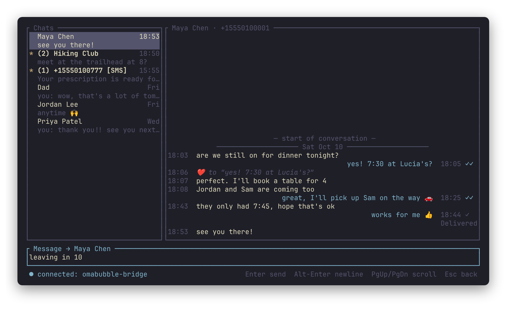
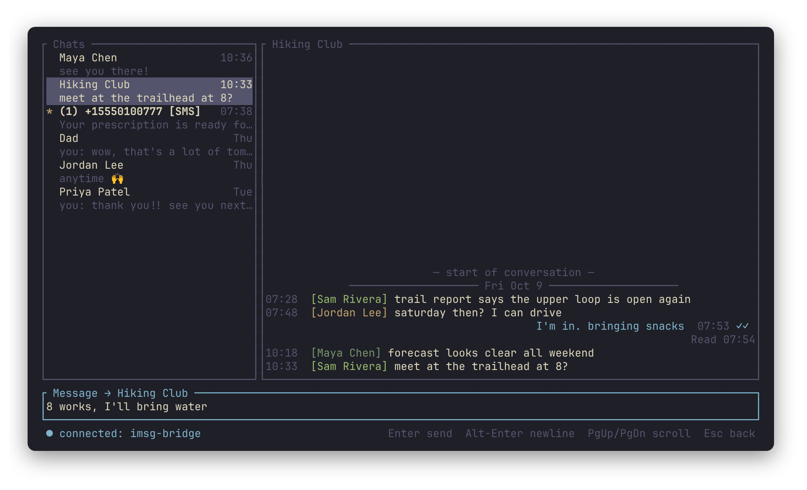

# imsg

iMessage in a terminal on a non-Apple machine. A Mac that stays signed in to
Messages runs **`imsg-bridge`**. The Linux TUI **`imsg`** talks to it over SSH.
Chats show Contacts names when the Mac has them, otherwise bare phone numbers
and emails; `names = false` in the config shows handles only.

imsg is an independent project, not affiliated with or endorsed by Apple.
iMessage and Messages are trademarks of Apple Inc.





The screenshots use made-up demo data. `scripts/demo/run.sh` runs imsg against
that data with a local bridge, so no Mac is needed (sends are dry runs);
`scripts/demo/screenshots.sh` regenerates the images.

```
imsg (Linux) ──ssh, restricted key──> imsg-bridge connect ──unix socket──> imsg-bridge serve (LaunchAgent)
                                                                             ├─ reads ~/Library/Messages/chat.db (read-only)
                                                                             ├─ watches it with FSEvents, pushes new/edited/unsent messages
                                                                             └─ sends through Messages.app with osascript
```

The only network port is SSH. Full Disk Access is granted to `imsg-bridge`
alone, not to sshd.

## Build

The Rust version is pinned in `mise.toml`, and both machines use it via mise.

```sh
# Linux: the TUI
mise exec -- cargo build --release -p tui          # → target/release/imsg

# Mac, once: a self-signed code-signing identity (its own keychain, no prompts)
~/src/appl-tui/scripts/mac/make-signing-cert.sh

# Mac, every update, in a terminal (asks for your password):
# build, sign, install root-owned to /usr/local/bin, (re)load the service
~/src/appl-tui/scripts/mac/install-bridge.sh
```

Signing every build with the same identity makes macOS treat rebuilds as the
same app, so Full Disk Access and Automation survive updates. Unsigned builds
lose both permissions every time the binary changes. The binary and the
LaunchAgent plist are root-owned on purpose; see Security below.

`imsg --version` and `imsg-bridge --version` show the release and the commit
they were built from, e.g. `0.1.0 (455dfb1)`; `-dirty` marks a build with
uncommitted changes.

## Releases

imsg and imsg-bridge are released together under one version (see
`CHANGELOG.md`) and published to an artifacts site (`ARTIFACTS_URL`, served
with the layout `artifact-push` and `install.sh` use):

```sh
# Linux: install or update the TUI (to ~/.local/bin/imsg)
curl -fsSL https://artifacts.example.com/install.sh | sh -s -- imsg

# Mac, in a terminal (asks for your password): install the latest bridge,
# or name a version, e.g. --release v0.1.0
~/src/appl-tui/scripts/mac/install-bridge.sh --release
```

A published bridge is installed only if its checksum matches and it was
signed with this Mac's identity, so Full Disk Access carries over.

Copy `local.env.example` to `local.env` (not committed) and set your Mac and
artifacts site there. To make a release, add notes under `## Unreleased` in
`CHANGELOG.md`, then run `scripts/release.sh 0.2.0` on a clean `main`. It tests, commits and tags
`v0.2.0`, builds the TUI here and the bridge on the Mac (signed there),
publishes both with `artifact-push`, and pushes to GitHub. Published versions
can't be replaced, so a broken release is fixed with a new patch version.

## Mac setup (once)

1. **Install the service:** run `scripts/mac/install-bridge.sh` in a
   terminal on the Mac. It puts the binary at `/usr/local/bin/imsg-bridge`
   and the agent at `/Library/LaunchAgents/com.imsg.bridge.plist`, both
   root-owned, and loads the agent into your login session. Logs go to
   `~/Library/Logs/imsg-bridge.log`.
2. **Full Disk Access:** go to System Settings → Privacy & Security → Full
   Disk Access, click **+**, and add `/usr/local/bin/imsg-bridge`
   (⌘⇧G in the file picker to type the path). The agent retries every 10s
   and starts once this is granted.
3. **Automation permission:** the first real send makes macOS ask whether
   `imsg-bridge` may control Messages. Click Allow. If you miss the prompt,
   sends fail with `-1743`; turn it on under Privacy & Security → Automation.
4. **Stay reachable:**
   - Keep the Mac logged in. Messages.app itself can stay closed: incoming
     messages are written to chat.db by a background daemon, and a send
     launches Messages through AppleScript when needed.
   - Turn on "Prevent automatic sleeping" (Energy settings) or run `caffeinate`.
   - For SMS (green bubble) contacts, turn on Text Message Forwarding to this Mac on the iPhone.
   - **If the Mac is a VM:** its clock stops while the host sleeps and macOS
     doesn't catch up, which delays messages. `scripts/mac/install-timesync.sh`
     installs a root job that sets the clock from time.apple.com every 2
     minutes. imsg shows `⚠ Mac clock … behind` in the status bar when the
     Mac's clock is more than 2 minutes off.
5. **Restricted SSH key:** this key can only reach the bridge.
   - On Linux: `ssh-keygen -t ed25519 -f ~/.ssh/imsg -N ''`
   - On the Mac, add one line to `~/.ssh/authorized_keys`:
     ```
     restrict,command="/usr/local/bin/imsg-bridge connect" ssh-ed25519 AAAA…(contents of ~/.ssh/imsg.pub)
     ```
     `restrict` turns off pty, port/agent/X11 forwarding and `~/.ssh/rc`.
   - On Linux, add to `~/.ssh/config`:
     ```
     Host mac-imsg
         HostName 127.0.0.1
         Port 2233
         User b
         IdentityFile ~/.ssh/imsg
         IdentitiesOnly yes
     ```

   For use away from home, use Tailscale and the Mac's Tailscale name rather
   than forwarding port 22 on your router.

To remove the service, run `sudo imsg-bridge uninstall`.

**Re-granting permissions:** this is only needed if the binary's identity
changes, for example after switching from unsigned to signed or recreating the
certificate. Remove `imsg-bridge` from the Full Disk Access list and add it
again, then allow the Automation prompt on the next send. Over VNC, this opens
both windows for you:
`open -R /usr/local/bin/imsg-bridge; open "x-apple.systempreferences:com.apple.preference.security?Privacy_AllFiles"`

## Linux setup

`~/.config/imsg/config.toml` (running `imsg` without one prints this sample):

```toml
host = "mac-imsg"
country_code = "1"      # prepended to 10-digit numbers in the new-conversation popup
notifications = true    # notify-send for messages in chats you aren't looking at; on Hyprland, clicking one opens the chat in imsg's window
notification_detail = true  # false: notifications say only "New message" (see Security)
notification_seconds = 20   # how long banners stay up; 0 = until dismissed (Omarchy allows 8–30)
bell = false
# ssh_args = ["-p", "2233"]                                   # if the host alias doesn't cover it
# remote_command = "/usr/local/bin/imsg-bridge connect"       # only for keys without a forced command
```

Then run `imsg`, or `imsg <host>` to override the configured host.

### One person, several handles

`chat.db` keeps a separate chat row per handle, so a contact you message by
both phone number and email has two rows, and Messages may file your sent copy
under either. Messages.app shows them as one conversation by consulting
Contacts, and the bridge does the same: it reads each card's phone numbers,
email addresses and link id from `~/Library/Application Support/AddressBook/`
(covered by the Full Disk Access grant), matches them against the handles in
`chat.db`, and tells the TUI which handles belong to one person. With
`names = true` (the default) the chat list shows the Contacts name, the
conversation title shows the name with its handles, and group messages are
prefixed with the sender's name. Set `names = false` to see handles only;
then only the groupings cross the wire.

For someone Contacts doesn't link, add an override:

```toml
[[person]]
name = "Alex"            # optional: shown instead of the handles
handles = ["+15551234567", "alex@example.com"]
```

If a sent copy still lands in a sibling chat that isn't merged, the TUI counts
it as sent and shows a hint naming the two handles. `imsg-bridge serve
--no-contacts` turns the Contacts lookup off, and `imsg-bridge query people`
prints only counts.

## Keys

| Where | Key | Action |
|---|---|---|
| Chat list | `j`/`k`, arrows, `g`/`G` | Move |
| | `Enter` | Open chat |
| | `n` | New conversation (number or email) |
| | `d` / `Delete` | Hide the chat on this machine until a new message arrives (the Mac and phone keep it); `u` undoes the last hide |
| Anywhere | `Tab` / `Shift-Tab` | Cycle focus: list → messages → input |
| | `PgUp` / `PgDn` | Scroll; at the top, older history loads |
| | `q` (outside the input), `Ctrl-C` | Quit |
| | `r` | Reconnect now, when disconnected |
| Input | `Enter` | Send |
| | `Alt-Enter` | Newline |
| | `Ctrl-W` / `Ctrl-U` | Delete word / clear |
| | `:` + two letters | Emoji completion (`:thu` → 👍); Tab/↑↓ choose, Enter insert, Esc close. A full `:fire:` converts when you type a space |
| | `Ctrl-E` | Emoji picker: recently used first, type to search by shortcode or name |
| | `Esc` | Back to the list (what you typed stays as that chat's draft) |
| Messages pane | `j`/`k` | Select a message |
| | `y` | Copy the selected message |
| | `Y` | Copy with `[time sender]` |
| | `v` | Start or cancel a range; `y`/`Y` then copy the range |
| | `Enter` on a failed message | Put its text back in the input to resend |
| | `Enter` on a message with pictures | View them full-pane: `←/→` between pictures, `o` save to `~/Downloads` and open, `Esc` back |
| | `x` on a failed message | Discard it |
| | `Esc` | Cancel range / back |

Pasting uses bracketed paste, so multi-line text lands in the input box and
isn't sent until you press Enter. Copying writes OSC 52 (works over SSH, and in
tmux with `set-clipboard on`), and also uses `wl-copy`/`xclip` when available.

Unsent text stays with its chat: switch away and the chat list shows
`✎ Draft: …` in place of the last message (or a `✎` after the name while it
has unread messages); switch back and it's in the input again. Sending or
emptying the input clears it. Drafts are saved to
`~/.local/state/imsg/drafts.json` (readable only by you), about two seconds
after you stop typing and when you quit, so they survive restarts. They stay
on this machine.

Pictures show as thumbnails in the conversation, 8 rows tall, loaded as they
scroll into view. foot draws them with Sixel, kitty and Ghostty with the Kitty
protocol, and other terminals (and anything inside tmux, screen or zellij) with
coarse half-block characters. A picture only partly on screen shows its name
until it's fully in view. Other attachments stay text labels; set
`images = false` to show pictures as labels too. Select a message with
pictures and press Enter to view them full-pane (up to 1600 px); `o` saves the
one shown to `~/Downloads` (the right way up, without metadata) and opens it.

Mouse: click a chat to open it, click a pane to focus it (a click in the
messages pane also selects that message), and scroll with the wheel. Because
the app captures the mouse, hold Shift to drag-select text with the terminal;
or set `mouse = false` to leave the mouse to the terminal entirely.

## Send status

| Shown | Meaning |
|---|---|
| `sending…` | Handed to the bridge, waiting for the message to appear in chat.db |
| time | Confirmed: the message is in chat.db |
| `✗ failed` | osascript failed (the reason flashes in the status bar), or Messages marked it with an error. A failed message keeps its place as newer ones arrive; select it and press Enter to resend or `x` to discard |
| `? unconfirmed` | The bridge said it sent, but no copy appeared in chat.db within 30s; or the bridge never answered (it waits up to 2 minutes for Messages, e.g. for a permission dialog); or the connection dropped mid-send |
| `10:42 ✓` / `10:42 ✓✓` | After the time on every message you sent: delivered / read (`Read` needs the other person to share read receipts) |
| `10:42 SMS` | Went over SMS; text messages are green, iMessages blue |
| `10:42 ✗` | Messages accepted the send but reported a failure later; the status bar flashes once, and the chat list shows `✗` |
| `Delivered` / `Read 10:44` / `Sent as Text Message` / `Not Delivered` | Spelled out under your latest message only |

## Limitations

- Edits and unsends from other people (or your phone) show up, but you can't
  edit or unsend from the TUI: AppleScript has no command for either.
- Reading a chat here doesn't mark it read on the Mac or phone.
- Delivered/read receipts, typing indicators, sending attachments and tapbacks
  aren't supported.
- New messages only arrive while the Mac is awake and online. After a
  reconnect, the TUI catches up on everything it missed.

## Security

What the design protects against, and what it doesn't.

- **Network:** the only inbound port is SSH, key-only, and the imsg key is
  `restrict`ed to the forced command `imsg-bridge connect`: no shell, no pty,
  no forwarding. The bridge's socket is local-only, 0600 in a 0700 directory.
  Use Tailscale for remote access rather than exposing SSH.
- **The Linux box is fully trusted.** Whoever holds `~/.ssh/imsg` can read
  every message, see which handles Contacts groups together (and names, if
  `names = true`), and send as you. The key has no passphrase for
  convenience; treat the file accordingly.
- **Same-user processes on the Mac can use the bridge.** Full Disk Access
  belongs to `imsg-bridge`, and the bridge serves whatever connects to its
  socket. Other *users* are kept out by the socket permissions, but anything
  already running as you, with no Full Disk Access of its own, can connect,
  read all your messages and send through it. That is inherent to this
  design (a BlueBubbles server has the same property, over the network).
  Don't run the bridge on a Mac where you run software you don't trust.
- **Root-owned binary and plist.** Because the signing key lives in a
  keychain on the same account, code running as you could re-sign its own
  binary as `com.imsg.bridge`. It can't swap it into `/usr/local/bin` or
  `/Library/LaunchAgents` without your password, which is why those are
  root-owned. Keep SIP enabled; nothing here needs it off.
- **Logs** never contain message text or recipients: send failures are
  logged with phone numbers and emails redacted, and `--dry-run-send` is the
  only mode that logs a message's argv.
- **Notifications** carry the sender and a preview, and desktops (Omarchy
  included) keep a notification history on disk. Set
  `notification_detail = false` to notify with just "New message".
- **Pictures:** a request names an attachment by id, never a path. The bridge
  serves it only if chat.db lists it as a picture type (JPEG, PNG, GIF, HEIC,
  WebP, TIFF), the file sits inside `~/Library/Messages/Attachments` once `~`
  and symlinks are resolved, and it's under 50 MB. `sips` converts it to a
  resized JPEG in a private temp directory that's removed straight after; the
  bridge then strips every EXIF, XMP, IPTC and comment block (location
  included) and sends the orientation separately. Previews over 2 MB are
  refused. Nothing is
  cached on disk on either machine.
- **Input handling:** recipients and message text reach `osascript` as
  argv, never spliced into the script; all SQL is parameterised except
  integer chat ids; request lines over 1 MiB are rejected.
- Dependencies are checked with `cargo audit`.

## Development

Everything can run against a fake database, without touching real messages:

```sh
sqlite3 /tmp/fx.db < bridge/tests/fixtures/make_fixture.sql
cargo run -p bridge -- serve --db /tmp/fx.db --socket /tmp/imsg/b.sock --dry-run-send
# TUI config for local testing:
#   command = ["/path/to/target/debug/imsg-bridge", "connect", "--socket", "/tmp/imsg/b.sock"]
cargo run -p tui -- --config /tmp/imsg-dev.toml
```

- `--dry-run-send` logs the exact osascript argv instead of running it.
- `imsg-bridge query --db <path> chats|history <id>|since <rowid>` prints raw JSON.
- `cargo test --workspace` covers:
  - DB queries, attributedBody decoding and change detection
  - the socket server
  - send/echo matching, reconnect catch-up and copy ranges
  - phone normalization and emoji-safe wrapping

Protocol: newline-delimited JSON, defined in `proto/src/lib.rs`. The bridge
sends `hello` with a protocol version first. On a mismatch, the TUI refuses to
continue and asks you to rebuild.

## License

MIT; see [LICENSE](LICENSE).
